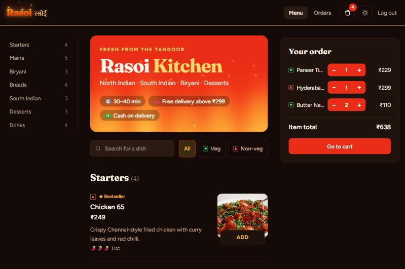
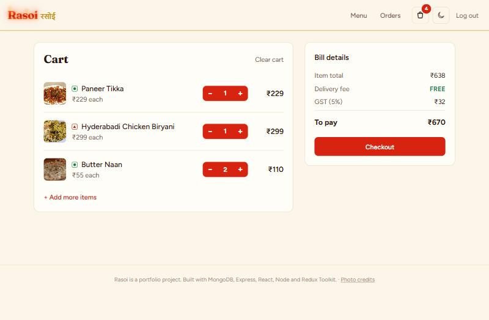
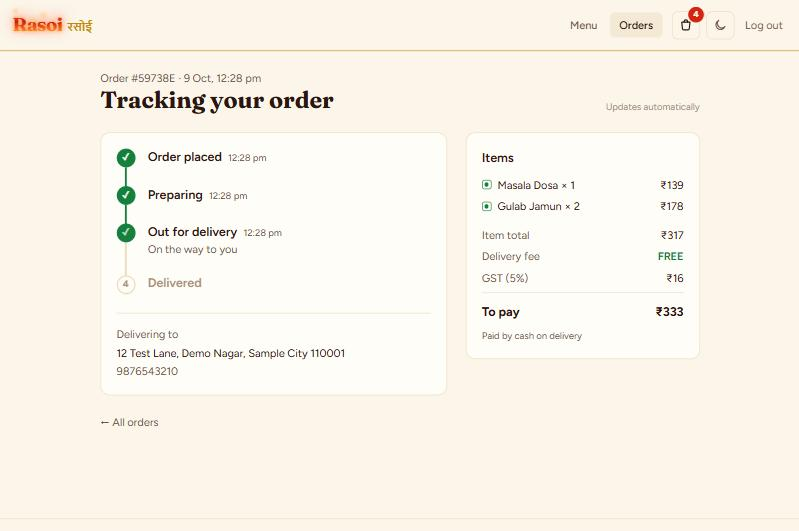
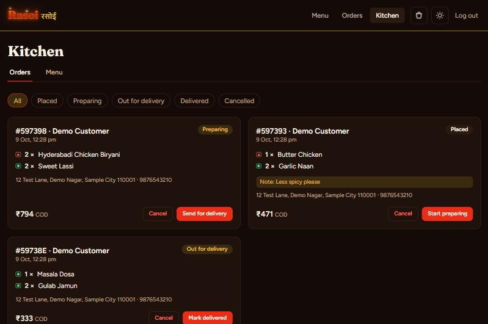

# Rasoi: an Indian food ordering website (MERN + Redux Toolkit)

Customers browse the menu, add dishes to a cart, place a cash-on-delivery order and watch its status change live. The restaurant (admin) sees incoming orders, moves them along (preparing → out for delivery → delivered) and manages the menu.

**Tech:** MongoDB · Express · React · Node.js · Redux Toolkit (RTK Query) · Tailwind CSS · JWT login

**Live demo: [rasoi-opal.vercel.app](https://rasoi-opal.vercel.app)** · Kitchen (admin) login: `admin@rasoi.test` / `admin12345`

> Hosted on free plans (Vercel + Render + MongoDB Atlas). If nobody has used it for a while, the first load can take up to a minute while the server wakes up.

## Screenshots

| Menu (night mode) | Cart and bill (day mode) |
|---|---|
|  |  |
| **Live order tracking** | **Kitchen dashboard (admin)** |
|  |  |

## Features

- **Menu** grouped by category with real dish photos, search, *All / Veg / Non-veg* filters, veg/non-veg marks, bestseller tags and spice levels
- **Little touches:** a burning logo, a fire animation on the banner, and a "cooking" animation when you add a dish
- **Cart** saved in Redux and in the browser, so it survives a refresh
- **Bill** with free delivery above ₹299, ₹40 delivery fee below that, and 5% GST
- **Secure prices:** the browser only sends dish IDs and quantities; the server looks up the real prices, so nobody can change a price from the browser
- **Login and sign up** with hashed passwords (bcrypt) and JWT tokens
- **Order tracking:** a timeline that updates by itself every few seconds; customers can cancel before the kitchen starts
- **Kitchen dashboard (admin):** incoming orders with one-click status buttons, and a menu editor (add dishes, change prices, mark out of stock, delete)
- **Day and night mode**
- **API tests** for login, menu, pricing and orders

## Run it on your PC

You need **Node.js 20 or newer**. MongoDB does **not** need to be installed: if no database address is set, the server starts a small local MongoDB by itself and keeps the data in your user folder (`AppData\Local\rasoi-db` on Windows).

**Easiest (Windows):** double-click **`start-rasoi.bat`**. The first run installs packages, then the site opens at http://localhost:5173.

**By hand:**

```bash
cd server
cp .env.example .env      # then set JWT_SECRET to any long random text
npm install
npm start                 # API on http://localhost:5000

cd ../client
npm install
npm run dev               # website on http://localhost:5173
```

On the first start the server adds 26 sample dishes and an admin account:

| | Email | Password |
|---|---|---|
| Admin (kitchen) | `admin@rasoi.test` | `admin12345` (change `ADMIN_PASSWORD` in `server/.env`) |

Customers just sign up on the site.

**Tests:** `cd server && npm test` (uses its own temporary database). On Windows, `run-tests.bat` runs the tests and builds the website.

## Project structure

```
rasoi/
├── server/                 Express API
│   ├── src/
│   │   ├── server.js       starts everything
│   │   ├── app.js          Express app: routes and error handling
│   │   ├── db.js           connects to MongoDB (or starts a local one)
│   │   ├── config.js       settings from .env and the pricing rules
│   │   ├── pricing.js      subtotal, delivery fee, GST, total
│   │   ├── seed.js         sample menu and admin account
│   │   ├── models/         User, MenuItem, Order (Mongoose)
│   │   ├── middleware/     auth.js: JWT login check, admin check
│   │   └── routes/         auth.js, menu.js, orders.js
│   └── tests/api.test.js
└── client/                 React website
    └── src/
        ├── store/          Redux: store, cartSlice, authSlice, api (RTK Query)
        ├── pages/          Menu, Cart, Checkout, Orders, OrderDetail, Login, admin/
        ├── components/     DishRow, QtyButton, BillSummary, StatusTimeline, Layout...
        └── lib/pricing.js  bill rules shown in the cart
```

## API

| Method | URL | Who | What |
|---|---|---|---|
| POST | `/api/auth/register` | anyone | sign up, returns a token |
| POST | `/api/auth/login` | anyone | log in, returns a token |
| GET | `/api/auth/me` | logged in | current user |
| GET | `/api/menu?category=&veg=true&q=` | anyone | menu (available dishes) |
| POST / PATCH / DELETE | `/api/menu/:id` | admin | add, edit, delete a dish |
| POST | `/api/orders` | logged in | place an order `{ lines: [{ item, qty }], address, phone, note }` |
| GET | `/api/orders/mine` | logged in | my orders |
| GET | `/api/orders/:id` | owner or admin | one order |
| POST | `/api/orders/:id/cancel` | owner | cancel while still "placed" |
| GET | `/api/orders?status=` | admin | all orders |
| PATCH | `/api/orders/:id/status` | admin | change status |

## Dish photos

The photos in `client/public/dishes` come from Wikimedia Commons under Creative Commons licenses. Each photographer is credited on the site's **Photo credits** page (`/credits`, data in `credits.json`). `server/scripts/fetch-dish-photos.mjs` downloads them again if needed (`get-photos.bat` on Windows), and `update-menu.bat` puts the photo links into the database.

## Deploying (optional)

1. Create a free database on **MongoDB Atlas** and put its connection string in `MONGODB_URI`.
2. Deploy `server/` to a Node host such as Render with `MONGODB_URI`, `JWT_SECRET`, `ADMIN_EMAIL`, `ADMIN_PASSWORD` and `CLIENT_ORIGIN` (your website's address).
3. Deploy `client/` to Vercel or Netlify with `VITE_API_URL` set to the server's address.

## Author

**Ayush Rawat** · [GitHub](https://github.com/AyushRawat7878)
